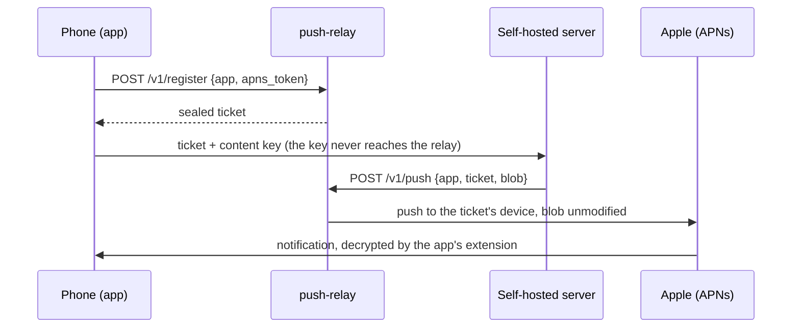

# push-relay

[](https://github.com/frederikberg/push-relay/actions/workflows/ci.yaml)
[](https://github.com/frederikberg/push-relay/releases)
[](https://opensource.org/licenses/MIT)

A small, stateless relay that forwards encrypted push notifications to Apple for any number of
iOS apps. Only an app's publisher can sign pushes for its bundle id, so a self-hosted server that
wants to notify its phone sends the push through the publisher's relay instead of holding an
Apple credential of its own. The relay forwards ciphertext and learns almost nothing.

## Why

- **Self-hosters run only their own server.** No Apple account, no key, no second container: the
  server posts to a URL compiled into the app.
- **The relay cannot read what it forwards.** The notification text is encrypted for the phone's
  notification extension; the relay sees a size and a time.
- **No account or sign-up.** The phone registers its token and gets a sealed, expiring ticket;
  that ticket is the only credential, and it works for one device of one app.
- **Nothing is stored.** No database, no volume, no state to back up or lose.
- **One relay for several apps.** Each app has its own topic, banner text, payload key and
  limits, and a ticket cannot push to another app's topic. One Apple key, one deployment.

## How it fits together



The relay opens the ticket to recover the device token and forwards the push. It never sees which
server sent it beyond the caller's IP address, and never why. [docs/api.md](docs/api.md) is the
full contract.

## What you need

To run your own relay: an Apple Developer team key for your apps, a Kubernetes cluster (or
anything that runs a container), and a hostname. To use someone else's relay, nothing: the app you
install already knows its relay.

## Run your own

```
helm install push-relay oci://ghcr.io/frederikberg/charts/push-relay \
  --version <version> --namespace push-relay --create-namespace -f values.yaml
```

[docs/operations.md](docs/operations.md) has the values, the two Secrets the chart expects, how to
add an app and how to rotate keys. Without Kubernetes, the image runs as it is:

```
docker run -e TICKET_KEYS=... \
  -v ./override.yaml:/config-custom/config.yaml:ro \
  -v ./AuthKey.p8:/secrets/apns/AuthKey.p8:ro \
  -p 8080:8080 ghcr.io/frederikberg/push-relay:<version>
```

## Configuration

Every option and its default is in [config/config.yaml](config/config.yaml), commented; a
deployment supplies a sparse override file and, for scalars, `PUSH_RELAY_<SECTION>_<KEY>`
environment variables. The secrets are the `.p8` file and `TICKET_KEYS`. The process refuses to
start on anything missing or misspelled.

## Docs

- [docs/api.md](docs/api.md) — the HTTP contract, rate limits, metrics, ticket format.
- [docs/operations.md](docs/operations.md) — running a relay: chart, configuration, apps, legacy
  tickets, key rotation, what the operator sees.
- [docs/development.md](docs/development.md) — building, testing, releasing.

## What leaves the machine

The relay sees, per request and only for its duration: the caller's IP address, the device token,
the app, the push type, and the blob's size and timing. It never sees a notification's content, a
badge count or an account. Logs and metrics carry the ticket's fingerprint, the app and the
outcome; never a token, a ticket or a blob. Apple receives what any push carries: the device
token, the topic, the fallback banner text and the encrypted blob.

## Known limitations

- **One relay is one point of failure.** While it is down, no push arrives; the apps still sync
  when opened.
- **Rate limits are per process.** A restart resets them and a second replica doubles them.
- **One Apple team per relay.** Apps of another team need their own instance.
- **No unregister.** A ticket ends by expiring or by its key being dropped.

## Prior art

The same split exists elsewhere: Home Assistant's mobile apps push through a service the project
runs, and Nextcloud's apps through its push proxy. This project shares no code with either.

## Not affiliated

Apple, iOS and the Apple Push Notification service are trademarks of Apple Inc. This project is
not affiliated with, endorsed or sponsored by Apple.

## License

[MIT](LICENSE)
